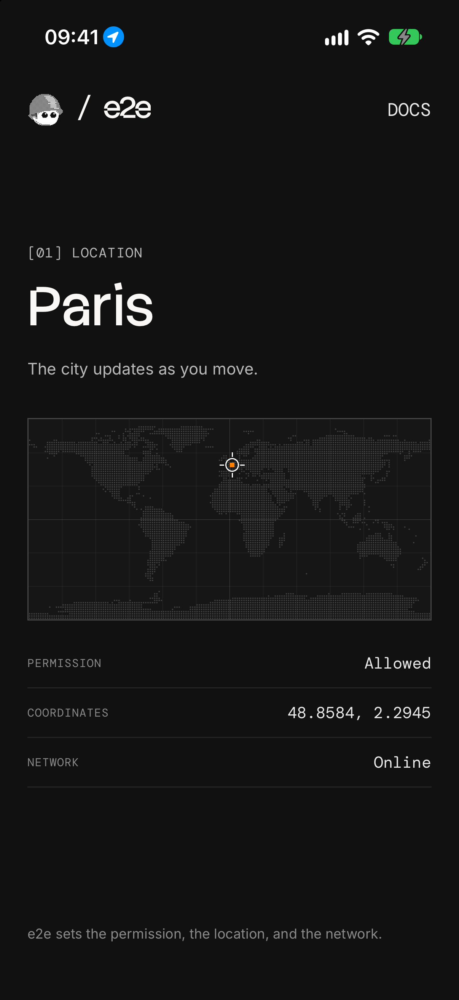

# e2e-location

An Expo app with one Find me button that asks for location and shows the city you're in, used as an example of end-to-end testing the system's permission prompt, the device's location, going offline, and the Settings app, on iOS and Android, with [e2e](https://www.npmjs.com/package/e2e).



## How it works

The app uses `expo-location` and the platform's own geocoder, so there are no accounts or keys:

- **Find me** (`src/app/index.tsx`) asks for location only when tapped, then follows the device: the first update is where it is now, and every move over 1 km looks the city up again (`src/hooks/use-location.ts`).
- **The city** comes from `reverseGeocodeAsync`: Apple's geocoder on iOS, Google Play services' on Android. The lookup gets 10 seconds, since Android's never answers offline.
- **Denied** explains why and offers Open Settings and Try again. A failed lookup keeps the coordinates and shows the error.

The readout shows the permission, the coordinates, and the network, each with a test id. The world map is drawn from [Natural Earth](https://www.naturalearthdata.com)'s public domain land data.

### Places

| Place                                  | Coordinates      | City      |
| -------------------------------------- | ---------------- | --------- |
| Eiffel Tower                           | 48.8584, 2.2945  | Paris     |
| Brandenburg Gate                       | 52.5163, 13.3777 | Berlin    |
| Near Dam Square, a new point every run | 52.37…, 4.89…    | Amsterdam |

The tests set these with `device.setLocation`. By hand, use Device Hub → Device → Location on a simulator, or the emulator's extended controls.

## Getting started

Use Node 22.22.3+, 24.8+, or 26+, with Xcode and an iOS simulator, or the Android SDK and an emulator ([Expo's setup guide](https://docs.expo.dev/get-started/set-up-your-environment/)). Pick an Android image with Google Play or Google APIs: Android's geocoder comes with Google Play services.

```bash
npm install
npm run ios       # or: npm run android
```

This builds the app in Debug, installs it on the running simulator or emulator, and starts Metro. Rebuild after native changes (`app.json`, packages with native code); JavaScript changes load from Metro.

## End-to-end tests

The tests in `tests/location.e2e.ts` allow and deny the system prompt, move the device, go offline, and turn location back on in Settings. They set the device up with the `device` fixture: `device.setPermission` resets or grants location, `device.setLocation` moves the device, and `device.setAirplaneMode` takes Android offline (an iOS simulator shares the Mac's network, so that test runs on Android only). The prompt is tapped by its buttons, which waits for Android's dialog to finish sliding in, and the app's screen is checked by test id. The Settings app differs between iOS and Android, so there the test uses one `agent.act` step. The prompt and Settings aren't the app's own screens, so a failed location test runs up to two more times. `tests/home.e2e.ts` checks that a fresh launch asks for nothing.

Only the Settings test needs a key: copy `.env.example` to `.env.local` and set `AI_GATEWAY_API_KEY`, as the agent model goes through the Vercel AI Gateway (or link a Vercel project). Without it, that test is skipped. When more than one simulator or emulator is booted, set `IOS_DEVICE` and `ANDROID_DEVICE` there too.

With the app installed on the simulator or emulator, run:

```bash
npx e2e run --target ios
npx e2e run --target android
```

Without `--target`, both run. The runner starts Metro, or uses the one already running. Configuration lives in `e2e.config.ts`.

## Scripts

| Command             | Description                                        |
| ------------------- | -------------------------------------------------- |
| `npm start`         | Start Metro                                        |
| `npm run ios`       | Build and run the Debug app on an iOS simulator    |
| `npm run android`   | Build and run the Debug app on an Android emulator |
| `npm run lint`      | Run ESLint                                         |
| `npm run typecheck` | Type-check with TypeScript                         |
| `npm run format`    | Format with Prettier                               |
| `npm run test:e2e`  | Run the e2e tests                                  |
